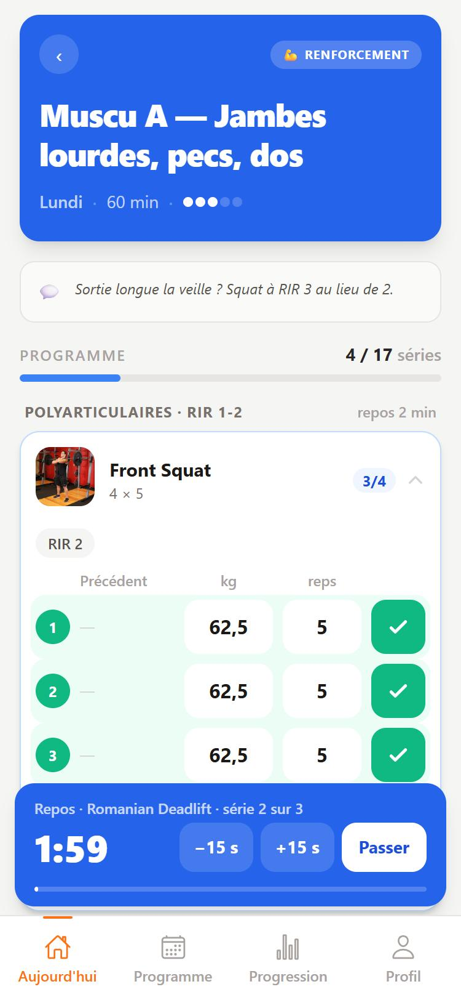
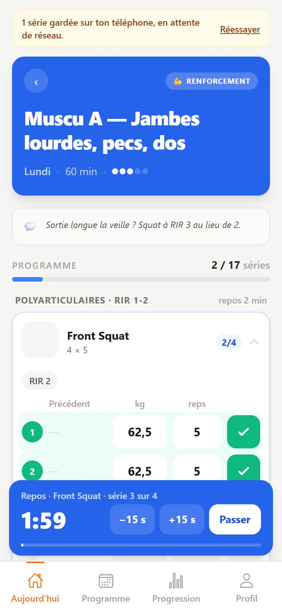

# Saisie en salle : chrono immédiat, valeurs reportées, repos à 2 min

Date : 7 octobre 2026. Retours de Thomas après sa première semaine de prépa. Spec et plan condensés dans ce seul document.

## Constat

1. **Le chrono part en retard.** Cocher une série attendait la réponse de Directus avant de marquer la série, de lancer le chrono de séance et le repos. En salle, avec peu de réseau, l'attente durait (aucun délai maximum) ; sans réseau, la série était refusée.
2. **La charge se retapait à chaque série**, même quand elle ne changeait pas.
3. **2 min 30 de repos, c'est long.** Semaine 1 au chrono : 49 à 59 min par séance. Thomas vise 50 min.

## Ce qui change pour l'athlète

| Geste | Avant | Après |
|---|---|---|
| Cocher une série | attend Directus, champs grisés | série cochée, chrono et repos lancés dans le geste |
| Sans réseau | « Série non enregistrée » | la série reste cochée et part dès que le réseau revient |
| Rouvrir une séance commencée, sans réseau | saisie bloquée | les séries déjà cochées sont là, la saisie est ouverte |
| Taper une charge ou des reps | vaut pour la série seule | vaut aussi pour les autres séries pas encore cochées |
| Série suivante, sans rien taper | propose la séance précédente | reprend la série qu'on vient de cocher |
| Repos des polyarticulaires (plan solo) | 2 min 30 | 2 min |

Un bandeau n'apparaît que si des séries attendent : « 3 séries gardées sur ton téléphone, en attente de réseau. »

## Règles

**Téléphone d'abord.** Une série cochée est écrite sur le téléphone, puis envoyée en arrière-plan.

- La boîte d'envoi garde l'état voulu de chaque série, pas la suite des gestes : cocher, corriger puis décocher ne laisse qu'une entrée, ou aucune.
- Un envoi à la fois, le plus ancien d'abord. Un appel sans réponse est abandonné après 15 s. Nouvel essai après 2 s, 4 s, 8 s, 16 s puis toutes les 30 s, au retour du réseau et au retour sur l'app.
- Un envoi parti sans réponse a peut-être réussi : avant de le refaire, on relit les séries de la séance.
- Deux lignes pour la même série sur le serveur : la seconde est supprimée. Ce n'est pas théorique : le navigateur renvoie de lui-même une requête dont la connexion a été coupée.
- Un refus du serveur (droit, donnée invalide) ne se réessaie pas tout seul : il s'affiche, avec « Réessayer » et « Abandonner ».
- La boîte est rangée par athlète et survit à la fermeture de l'app et à la déconnexion.
- Les requêtes envoyées à Directus sont les mêmes qu'avant : aucun changement de schéma ni de droits.

**Ouverture d'une séance.** La copie gardée sur le téléphone s'affiche tout de suite, Directus la met à jour dès qu'il répond. Sans copie, on laisse 1,5 s au réseau, puis la saisie s'ouvre de toute façon : une série cochée sans connaître l'état du serveur est rapprochée de ce qu'il a déjà, jamais créée en double.

**Valeurs reportées.** Une série à faire affiche, dans l'ordre : ce que l'athlète y a tapé ; sa dernière saisie dans l'exercice ; la dernière série cochée de l'exercice. Un champ resté vide propose en filigrane la séance précédente, sinon le prévu. Une série cochée ne change jamais toute seule ; décochée, elle garde ses valeurs. La saisie survit au repli de l'exercice, à un changement d'écran et à un rechargement.

**Repos.** Plan « Hyrox Solo Men » seulement : tout bloc de muscu au-dessus de 120 s passe à 120 s (24 blocs à 150 s). La durée prévue des séances de muscu suit le chrono : 60 → 50 min, 50 → 40 min en semaine allégée.

## Code

- `src/utils/outbox.js` : boîte d'envoi (état voulu, étape suivante, rapprochement avec le serveur, doublons). Pur, testé.
- `src/services/syncQueue.js` : l'envoi (ordre, reprises, relecture avant de refaire). Sans Vue ni navigateur, testé avec un faux serveur qui se tait, refuse ou perd ses réponses.
- `src/stores/setLogs.js` : séries affichées = séries connues du serveur + boîte d'envoi ; copie locale de la séance en cours ; saisie en cours.
- `src/utils/setLogs.js` : saisie d'un exercice (valeurs tapées, valeurs reportées), texte du bandeau.
- `ExerciseLogCard.vue` porte la saisie, `SetRow.vue` ne fait plus qu'afficher. `SyncNotice.vue` : le bandeau.
- `src/services/directus.js` : délai maximum d'un appel.
- `scripts/cap-strength-rest.cjs` : plafonne les repos (simulation par défaut, `--write`, `--restore`).
- `src/services/trainingService.js` : cache des séances renuméroté, pour lire les nouveaux repos sans attendre 24 h.

## Plan

- [x] Tests puis `outbox.js` et `syncQueue.js`.
- [x] Store des séries, carte d'exercice, bandeau.
- [x] Valeurs reportées : tests, puis carte et ligne.
- [x] Script des repos : simulation sur la prod, écriture essayée sur une copie locale.
- [x] Vérification dans le navigateur, `npm test`, `npm run build`.

## Vérifié

- 250 tests, dont 71 nouveaux. Quatorze bogues volontaires introduits un par un dans l'envoi : treize vus d'emblée par les tests, le quatorzième après l'ajout d'un test (l'ordre entre relecture et envois).
- Dans le navigateur, contre un faux Directus (réseau lent, coupé, muet, réponse perdue, refus) : série cochée et repos lancés avant toute réponse ; reprise après coupure ; réponse perdue sans doublon (le navigateur avait renvoyé la requête : deux lignes créées, une supprimée) ; série cochée puis décochée hors réseau sans trace ; rechargement en cours de séance ; première ouverture sans réseau ; refus puis abandon ; double appui ; valeurs reportées ; validation de séance avec une série encore en attente.
- Script des repos : simulation sur la prod (48 valeurs à écrire) ; écriture, relance, retour arrière et valeurs retouchées à la main essayés sur une copie locale en mémoire.

## Limites

- « Terminer la séance » attend toujours Directus : sans réseau, la validation échoue comme avant, et le chrono de séance continue.
- Une série envoyée plus tard porte l'heure de son envoi, pas celle du geste.
- L'app elle-même a besoin du réseau pour s'ouvrir ; le décompte du repos ne survit pas à un rechargement.
- Rien n'a été essayé sur un vrai téléphone.
